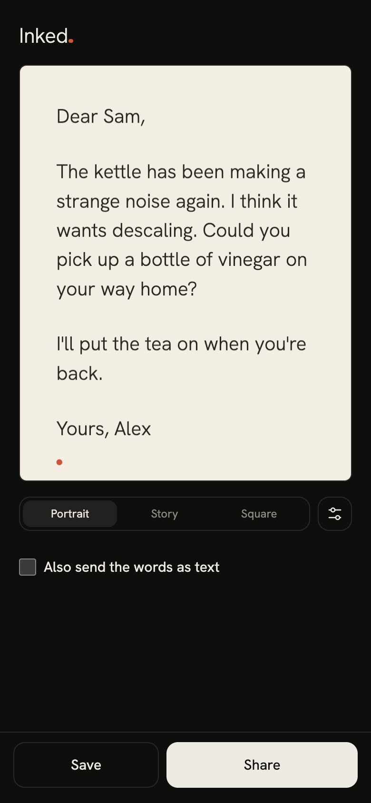

# Inked.

Inked. turns a letter into one themed image you can send in a chat app. Live at https://yashbmewada.github.io/inked/.



Your words stay on this device. The site is static files, makes no network requests beyond its own, and has no analytics. The letter and your settings are kept in the browser's local storage, and the app works without it.

## Run locally

```
python3 -m http.server
```

Open http://localhost:8000/. Opening index.html straight from disk (`file://`) does not work for sharing, because browsers only expose the share sheet and the clipboard on secure origins, and localhost counts as one.

## Deploy with GitHub Pages

Push to GitHub, then go to Settings, then Pages, and deploy from the `main` branch at `/`. All asset paths are relative, so it works under `<user>.github.io/<repo>/`. The empty `.nojekyll` file makes Pages serve the files as they are.

## Tests

```
npm test
```

Needs Node 20 or later. There are no dependencies to install.

## Add a theme

Add an entry to `THEMES` in `js/themes.js` with `id`, `name`, `group`, `font` (a key of `FONTS`), `texture`, `motif`, and `dark` and `light` colour sets, each made with `v(ground, ink, tint)`. Set `light` to `null` for a theme with a single look, and `motif` to `null` for no motif.

A new motif also needs two entries in `js/motifs.js`, both under the theme's `motif` key: a drawing function in `PAINT` and a position in `PLACEMENT`. `MOTIFS` is built from `PLACEMENT`, so it needs no edit. Update the theme id list in `tests/themes.test.js`.

## Fonts

Self-hosted, each under the SIL Open Font License 1.1. The licence text is next to each font in `fonts/`.

- Hanken Grotesk
- EB Garamond
- Kalam
- Courier Prime

## Licence

MIT. See LICENSE.
